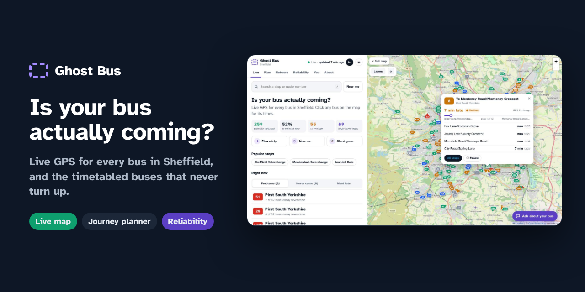
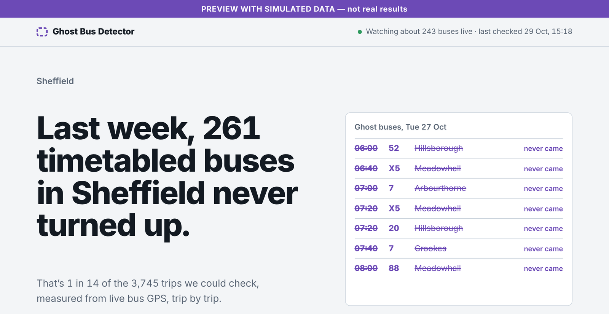
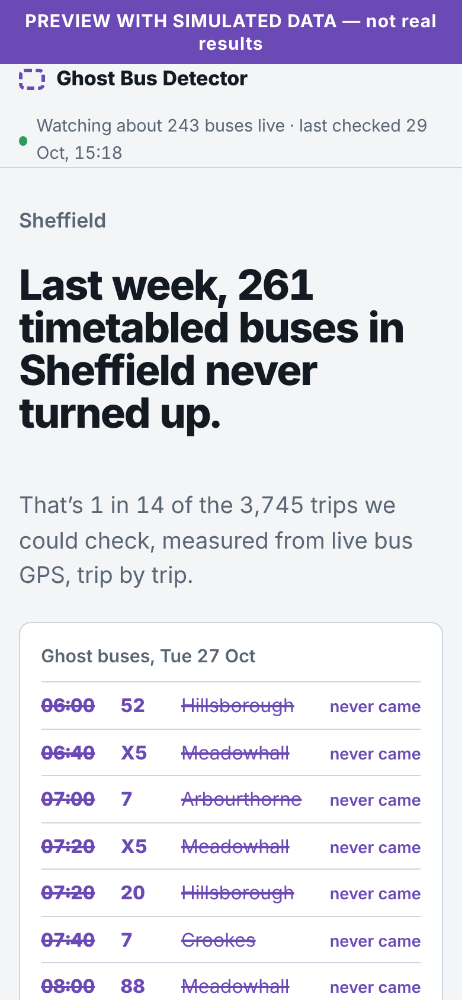
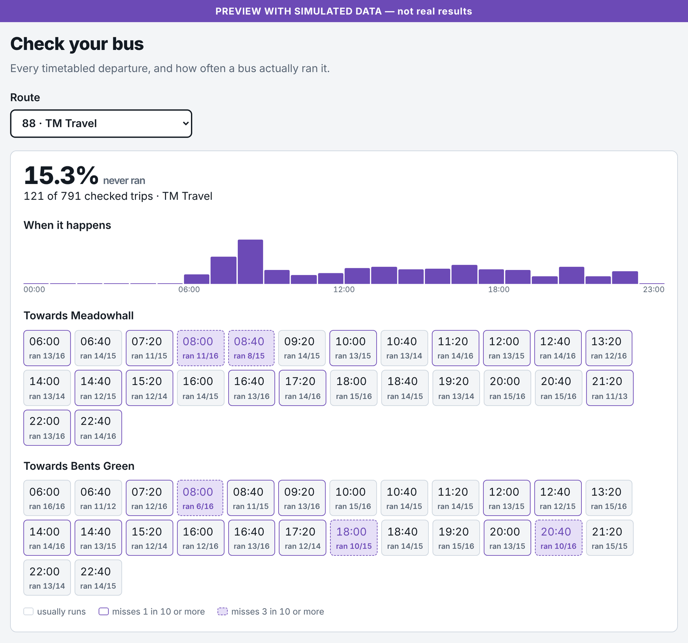
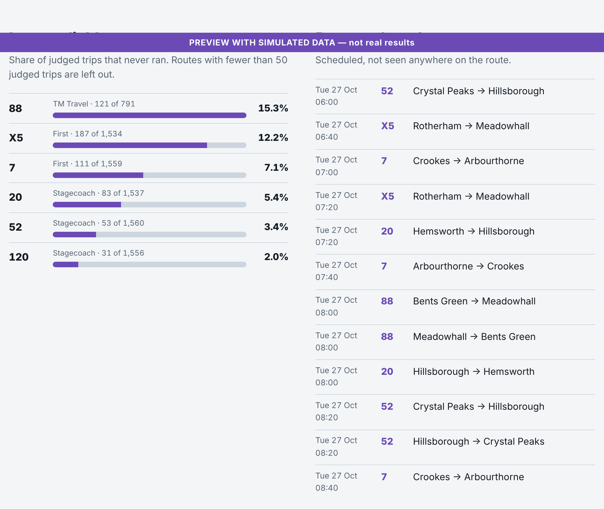
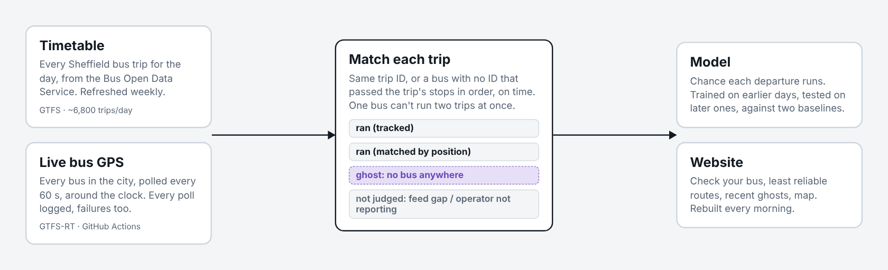
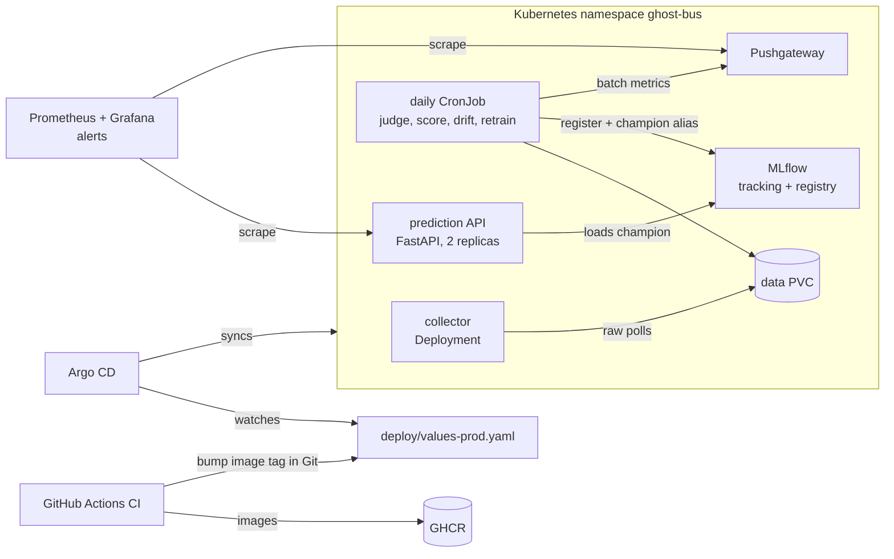

# Ghost Bus Detector

**Which timetabled buses in Sheffield never actually turn up?** This project counts them, trip by trip, from the government's live bus location feed.

**Live site:** https://mohammed-890.github.io/ghost-bus/



A "ghost bus" is on the timetable and often on the arrival board, but never comes. People wait in the cold, miss work and appointments, and nobody publishes how often it happens. Every bus in England reports its GPS position to the [Bus Open Data Service](https://www.bus-data.dft.gov.uk/) (BODS), and every operator publishes its timetable there. Put the two side by side for long enough, and the ghosts show up.

## What it looks like

> These screenshots use **simulated data** to show the design (it says so on each image). The live site only ever shows real results, and real screenshots replace these once collection has run.

| Home | On a phone |
|---|---|
|  |  |

**Check your bus:** every timetabled departure on a route, and how often a bus actually ran it. Dashed purple departures miss 3 in 10 times or more.



**Least reliable routes and recent ghost buses**



## How it works



```
BODS timetable (GTFS, weekly) ──► every trip scheduled in the city today
BODS live feed (GTFS-RT, every 60 s) ──► every bus position, around the clock
                     │
                     ▼
            match each scheduled trip
   1. a bus reported this exact trip ID          → ran (tracked)
   2. a bus with no trip ID passed the trip's    → ran (matched by position)
      stops in order, on time
   3. neither, while we were watching and the    → ghost
      operator was reporting other buses
   4. otherwise                                  → not judged
                     │
                     ▼
     daily results ──► model: chance each departure runs ──► website
```

- **Collector** (`ghostbus/collect.py`, GitHub Actions every 15 min): polls the GTFS-RT feed for the Sheffield bounding box every 60 seconds. Every poll is logged, failures included, so the analysis knows exactly when the feed was and wasn't watched.
- **Timetable** (`ghostbus/schedule.py`): downloads the Yorkshire GTFS from BODS weekly, cuts it to stops inside the city, and lists the trips running on each service day (calendar plus exceptions, times past midnight handled).
- **Matching** (`ghostbus/match.py`): the core. Up to 20% of live positions carry no trip ID ([BODS user forum](https://boduf.discourse.group/t/missing-trip-id-s-in-gtfs-rt-data/124)), so a trip with no exact match is checked against every untagged bus. It has to pass at least 40% of the trip's sampled stops (minimum 3) within 200 m, from 5 minutes early to 25 minutes late, **in the right order**. One bus can't explain two overlapping trips; the best matches are assigned first.
- **Fairness rules**: a trip is only called a ghost if the feed answered for at least 90% of the trip's polls, the operator had tagged buses visible in at least 80% of them, and the route was seen at least once that day. Anything else is *not judged* and is never counted against anyone.
- **Model** (`ghostbus/model.py`): predicts the chance each departure runs from route, operator, time of day, weekday, headway, and the recent history of that route, hour and exact departure. History features for a day only use earlier days, and the test set is the most recent 30% of days. It's compared with two baselines: the overall rate, and the departure's own past rate.
- **Website** (`docs/`): a static GitHub Pages site that reads JSON written by the daily job.

## Status

Collection started in late October 2026. The site shows real numbers only, and says so while it is still collecting. The model is trained once there are at least 7 judged days and 30 ghost buses. After that, the daily job retrains it when needed and only puts a new model live if it beats the current one (see below).

## Limits, honestly

- "Ghost" means *no bus was seen*. Causes include cancellations, driver shortages and buses running with their tracker off. Operators with poor tracking are protected by the fairness rules, but a bus that ran with its tracker off on a day the operator was otherwise reporting would still be counted.
- Matching by position can't tell two buses on the same road apart if neither has a trip ID; the one-bus-one-trip rule limits but doesn't remove this.
- Trips with fewer than 3 stops inside the city boundary aren't judged.
- One city, one region's timetable. The code works for any bounding box in England.

## Run it

```bash
pip install -r requirements.txt
python -m pytest -q                      # 26 tests: verdict rules, features, gate, drift, API
export BODS_API_KEY=...                  # free: https://data.bus-data.dft.gov.uk/account/signup/
python -m ghostbus.schedule refresh      # timetable
python -m ghostbus.collect --minutes 10  # live positions
python -m ghostbus.daily                 # judge finished days, build docs/data
```

In this repository the raw data, timetables and daily verdicts live on the [`data` branch](../../tree/data).

## Running it in production (MLOps)

The research pipeline above runs on GitHub Actions. The same code also runs as a small production system: a model registry with a promotion gate, a prediction API, Kubernetes, GitOps deploys, monitoring and automatic retraining.



| Piece | Where | What it does |
|---|---|---|
| Shared features | `ghostbus/features.py` | One function builds features for training **and** serving, so the two can't drift apart. History features only ever use days before the one being predicted. |
| Registry | `ghostbus/registry.py` | MLflow model `ghost-bus-runs` with a `champion` alias (or a local folder registry when no MLflow server is set). Every version keeps its params, test metrics, decision and drift reference. |
| Champion gate | `ghostbus/train.py` | A retrain is triggered by: no champion, the champion being 7 days old, drift (any feature PSI > 0.2), or live Brier 25% worse than at test time. The challenger only goes live if it beats the champion **on the same unseen days** (after the champion's last training day). Otherwise it is registered as rejected, with the reason. |
| Monitoring | `ghostbus/monitor.py`, `ghostbus/drift.py` | Every day the champion's predictions for tomorrow are stored, then scored once that day has been judged. Drift is PSI per feature against the champion's training data. |
| API | `ghostbus/serve.py` | `GET /predict?route=52&time=08:00` → chance it runs. `/healthz`, `/readyz` (model loaded), `/model`, `/routes`, `/metrics`. Picks up a newly promoted champion without a restart. |
| Images | `Dockerfile`, `docker/mlflow/` | Multi-stage, non-root (uid 10001), 187 MB. Scanned with Trivy in CI. |
| Helm chart | `chart/ghost-bus` | API (2 replicas, probes, PodDisruptionBudget, graceful shutdown), MLflow, daily CronJob, collector, Pushgateway, ServiceMonitor, alert rules and a Grafana dashboard. |
| Infrastructure | `terraform/` | A kind cluster, the monitoring stack, the BODS secret, and either the chart or Argo CD. |
| CI/CD | `.github/workflows/ci.yml` | Lint + tests → chart lint + schema check → Terraform validate → build + scan → **end-to-end on a real Kubernetes cluster** → publish to GHCR → bump the tag Argo CD deploys. |

### What the end-to-end test proves

Every push installs the chart on a fresh kind cluster, seeds a model, and checks:

- the API becomes ready only once it has loaded the champion from MLflow
- predictions make sense: the demo route 52 (built to fail often 07:00–09:00) gets **0.68 at 08:00 vs 0.97 at 12:00**
- unknown routes return 404 and `/metrics` is served
- **no dropped requests during a pod failure**: 300 requests while one API pod is deleted, **300 ok, 0 failed**

The model in that test is trained on **synthetic** data (`ghostbus/demo.py`), because the real data is still being collected. The model's real accuracy will be reported here once there are enough judged days. Until then, the only claim made is that the system works, not how accurate the model is.

### Run it yourself

```bash
# 1. Docker Compose: MLflow + API, with a demo model from synthetic data
docker compose up -d mlflow api
docker compose run --rm demo
curl "localhost:8000/predict?route=52&time=08:00"     # MLflow UI on localhost:5000

# 2. Kubernetes (kind) with Helm, the same way CI does it
kind create cluster --name ghost-bus --config deploy/kind/kind-config.yaml
docker build -t ghost-bus:ci . && docker build -t ghost-bus-mlflow:ci docker/mlflow
kind load docker-image ghost-bus:ci ghost-bus-mlflow:ci --name ghost-bus
scripts/e2e.sh

# 3. Terraform: cluster, Prometheus/Grafana and the app (or Argo CD with -var install_argocd=true)
cd terraform && terraform init && terraform apply -var bods_api_key=$BODS_API_KEY
```

With Argo CD, nobody runs `kubectl apply`: CI writes the new image tag to `deploy/values-prod.yaml`, and Argo CD rolls it out (`deploy/argocd/application.yaml`).

### What broke while building it

- **MLflow kept getting OOMKilled** in Kubernetes at 1 GiB. MLflow 3 starts about eight background job workers (around 250 MB each) for GenAI evaluation. Turning those off and running one web worker brought it to about 550 MB.
- **The first tuned model lost to a simple baseline.** It did worse than "this departure's own past rate" on 15 out of 15 time splits. A shallower, more regularised model beat both baselines on 15 out of 15.
- **Drift detection missed a real shift.** Quantile-binned PSI can't see a change in a feature with only a few values, like hour of day. Features with 30 or fewer distinct values now use PSI by value.
- **A champion "beat" a challenger on days it had trained on.** The gate now only compares the two on days after the champion's last training day.
- **The vulnerability scanner couldn't be installed.** Older Trivy releases had been removed upstream, so CI now pins a current release and fails only on fixable critical issues.

Design decisions and their trade-offs are in [`docs/adr/`](docs/adr/).

## Data licence

Contains public sector information licensed under the [Open Government Licence v3.0](https://www.nationalarchives.gov.uk/doc/open-government-licence/version/3/). Not affiliated with any bus operator or the Department for Transport.

Built by [Mohammed Banabilh](https://www.linkedin.com/in/mohammed-banabilh-6340553b0/). MIT licence.
